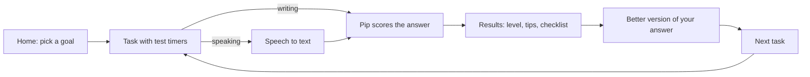
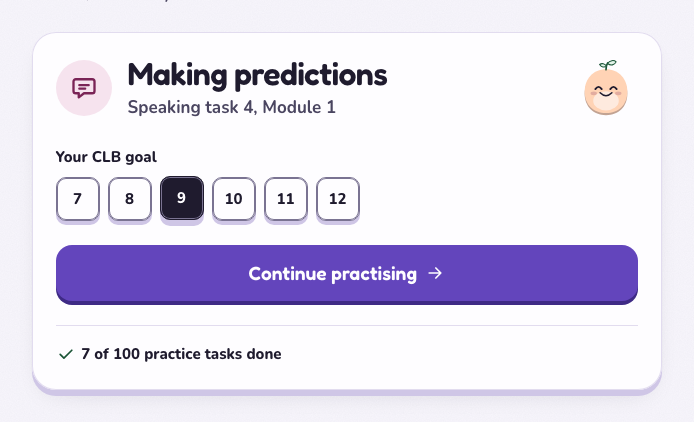
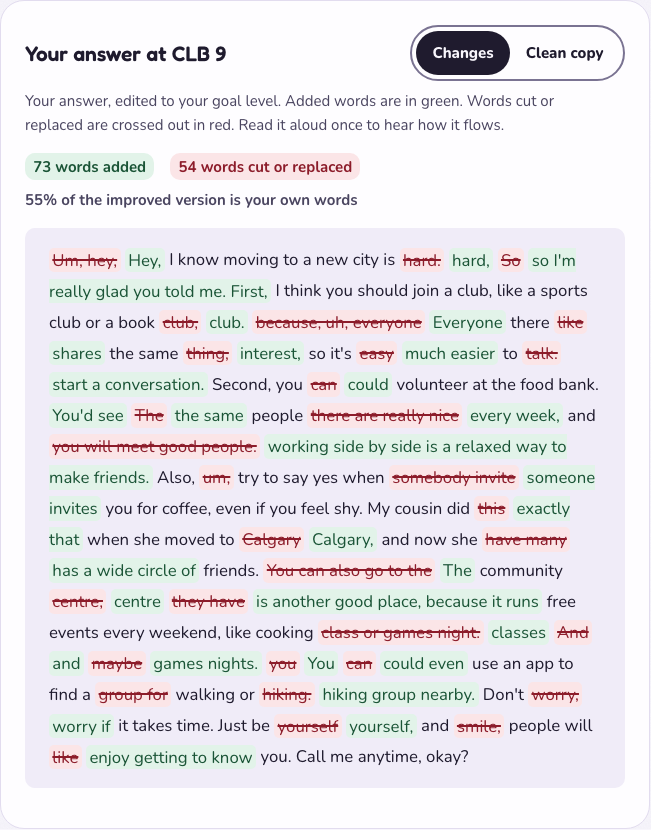
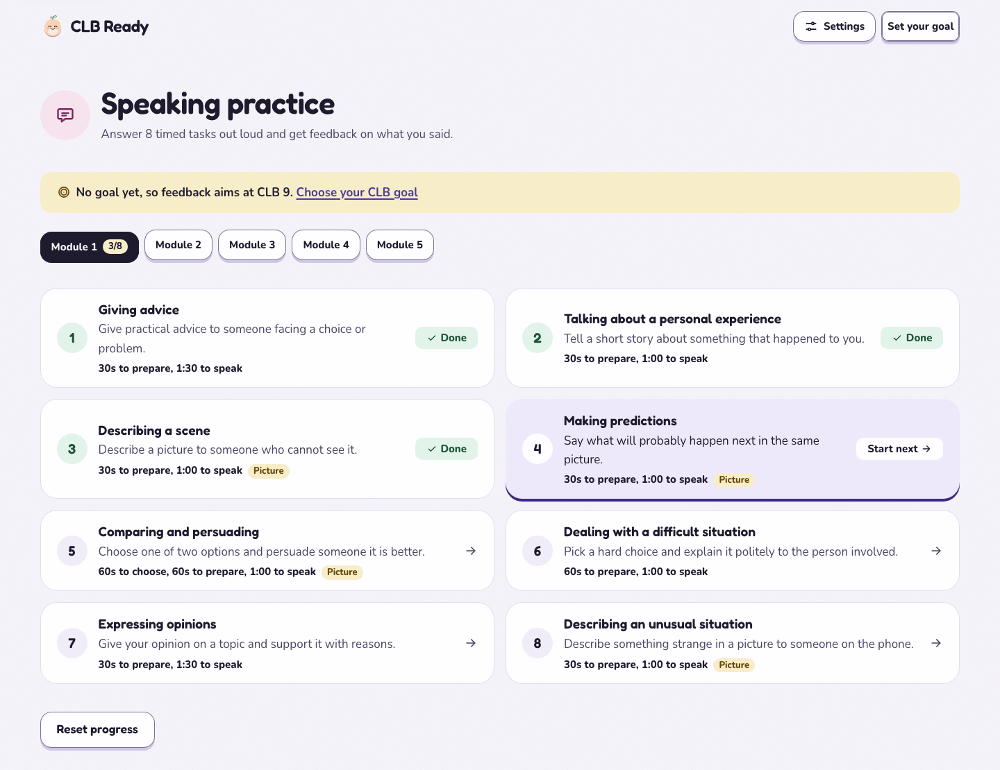
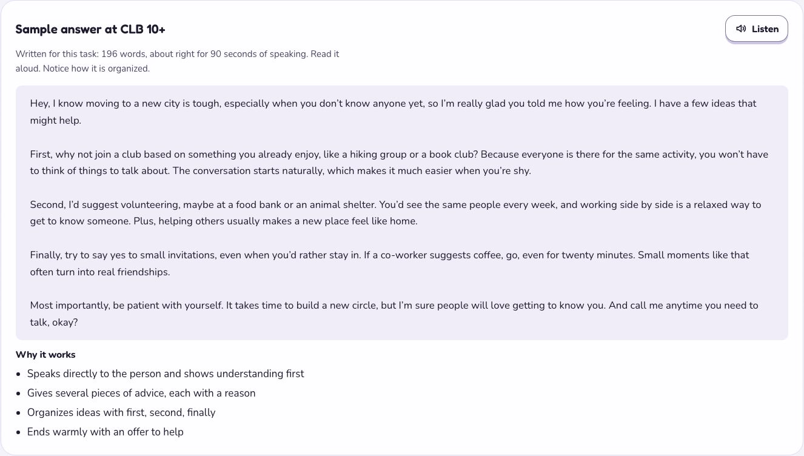
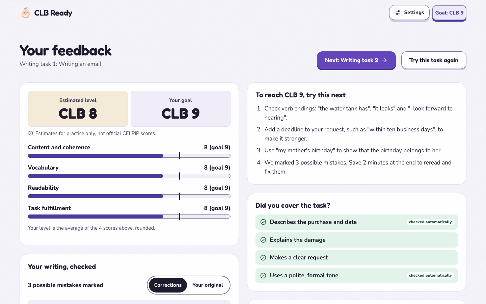
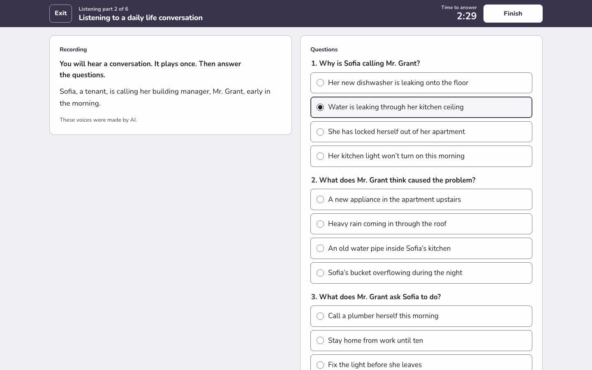
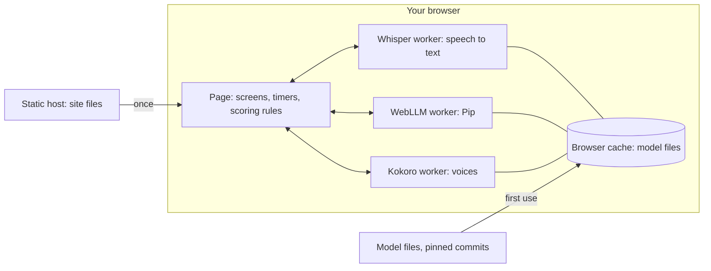

# CLB Ready

**Free CELPIP practice with Pip, an AI coach that runs in your browser.**

CLB Ready is for adults preparing for the CELPIP test for Canadian immigration or citizenship. You practise
all four skills under real test timers. Then Pip, your AI coach, checks that you answered the task and shows
your estimated CLB level next to your goal, with what to change to reach it. There is no account and no
payment, and nothing you say or write leaves your device.

**Try it:** [clbready.vercel.app](https://clbready.vercel.app) · also on
[GitHub Pages](https://jasleenminhas578.github.io/CLB_Ready/). Chrome or Edge on a laptop works best.


## 🎯 Why learners use it

- 📈 **See your estimated CLB level for every answer**, next to the goal you picked (CLB 7 to 12). Speaking and
  writing get a score for each of the four CELPIP criteria; reading and listening use CELPIP's approximate
  score chart.
- 🤖 **Know exactly what to fix.** Pip checks that your answer is on task, ticks off the task checklist and
  gives up to three short tips. Then it rewrites your answer at your goal level, with every change marked.
- ⏱️ **Practise under test-day conditions**: 5 practice tests with 40 speaking tasks, 10 writing tasks and
  380 reading and listening questions, each with test-style timers.
- 🗣️ **Learn from strong answers.** 40 sample answers at CLB 10+, sized to the speaking time, which you can
  read or hear aloud. Every reading and listening question has an explanation that quotes the line that
  proves it.
- 🧭 **Pick up where you left off.** One click starts your next unfinished task, and each skill shows how
  many tasks you have done.
- 🆓 **Practise as much as you like.** No account, no payment, no limit, and your answers stay on your device.

## 🧭 How it works



### 1️⃣ Pick a goal and start

Choose the CLB level you need on the start card. Start opens your next unfinished task. You can change the
goal at any time; without one, feedback aims at CLB 9.



### 2️⃣ Answer under test timers

Each task looks and runs like test day. In speaking, the preparation and recording timers run one after
another. A soft beep marks when each timer starts and ends, and the beeps are kept out of your recording.
You can turn them off with the Timer sounds setting.


### 3️⃣ Pip checks your answer

Your recording is turned into text on your device, and Pip reads it. The first time, Pip has to download,
which can take a few minutes. A panel shows which step Pip is on and how far the download has got.


### 4️⃣ See your level and what to fix

Feedback comes in two steps. First: your estimated level beside your goal, a score for each criterion, up to
three tips and the task checklist. No level shows until Pip has checked your answer, and an answer to some
other question can't earn a good level.


### 5️⃣ Read a better version of your answer

Second: Pip rewrites your answer at your goal level. Every word added, cut or replaced is marked, so you
can see what moves an answer up a level.



### 6️⃣ Go to the next task, or start again

Results lead straight to the next task. A task is ticked as done only when you gave an answer. Each module
and skill has a Reset progress button, and Settings can clear everything.



## 🗣️ Speaking

8 task types per practice test, from giving advice to describing an unusual situation, with the test's
preparation and speaking times (30 or 60 seconds to prepare, 1:00 or 1:30 to speak). Your answer is
transcribed and measured (pace, pauses, fillers, word variety), then scored and rewritten by Pip. Each task
also has a sample answer at CLB 10+ with notes on why it works and a Listen button.



## ✍️ Writing

An email and a survey response per practice test, in a test-style editor with a live word count against
the 150 to 200 word target. Your writing draft stays in the tab until you submit it. Feedback marks possible
grammar mistakes, scores each criterion, checks the task points and gives an improved version.




## 📖 Reading

4 parts per practice test: correspondence, applying a diagram, reading for information and reading for
viewpoints. Fill blanks and answer questions on the clock. Results show your score, an estimated level and,
for every answer, the line in the passage that proves it.


## 🎧 Listening

6 parts per practice test: problem solving, a daily life conversation, information, a news item, a
discussion and viewpoints. Each recording plays once, like test day, and
then the questions appear. Results explain every answer with a quote from the recording and show the full
transcript.




## 🔒 Private by design

CLB Ready has no server of its own: the site is static files. It downloads small open AI models into your
browser once, then runs everything on your own computer:

| Part | Tool | Where it runs |
| --- | --- | --- |
| Speech to text | Whisper (`.en` models) via Transformers.js | Web Worker, WebGPU or CPU |
| Feedback (Pip) | Qwen2.5 / Llama 3.2, 4-bit, via WebLLM | Web Worker, WebGPU |
| Listening voices and read-aloud | Kokoro 82M via kokoro-js | Web Worker, WebGPU or CPU |
| Measurements and grammar checks | Plain TypeScript (pace, pauses, fillers, learner grammar rules) | Main thread |
| Reading and listening marks | Answer key and CELPIP's approximate score chart | Main thread |
| Storage | Model files are cached; answers are never saved (a writing draft stays in the tab until you submit) | Browser |



- **Nothing you say or write leaves your device.** Apart from the site's own files, the only downloads are
  the models. There is no account, no analytics and no app server.
- **Pinned models.** Every model is pinned to an exact commit (`src/services/modelPins.ts`), so a change
  upstream can't swap what runs on your device.
- **No third-party code at runtime.** The ONNX Runtime WebAssembly file and the fonts are served from the
  site itself, not a CDN.
- **A strict Content Security Policy.** The built page only loads scripts, styles, fonts and data from the
  site itself.

The app checks the device (memory, CPU cores, WebGPU support) without asking for permission and picks model
sizes to match. Devices without WebGPU get light mode, where Pip is off: results show the measured scores
(vocabulary and how clear your answer is) and say that a level needs Pip.


## 🏫 For teachers and settlement programs

Share one link. There's nothing to install, no accounts to manage and no student data to protect, because
none is collected. Students get 5 full practice tests across all four skills, feedback aimed at the level
they need, and a sample answer for every speaking task. Progress ticks are kept in each student's own
browser, and it also works on phones.


## 💻 Run it locally

You need Node.js 20 or newer.

```bash
npm install
npm run dev        # then open http://localhost:5173 in Chrome or Edge
npm test           # unit tests
npm run typecheck  # TypeScript check
npm run build      # production build in dist/
npm run audio      # optional: pre-record listening audio (see below)
```

Every push to `main` runs the tests and publishes the site to GitHub Pages (GitHub Actions).

## 🔊 Listening recordings

By default, Kokoro makes the listening voices in the learner's browser, a line at a time while the
recording plays. `npm run audio` can instead pre-record clips as MP3 files in `public/audio/`; the app
plays a recording when one exists. It needs internet the first time (about 330 MB for the model) and
ffmpeg (`brew install ffmpeg` on a Mac). To skip onnxruntime-node's GPU (CUDA) download, install
with `ONNXRUNTIME_NODE_INSTALL_CUDA=skip npm install`.

## 🧪 Model lab

Open `#/lab` (the "Model lab" link in the footer) to measure load time, transcription time, tokens per
second and memory on your device.

## 🗂️ Project structure

```
src/
  app/          router, session state, route table
  components/   shared UI (buttons, icons, Pip, layout, disclaimer)
  domain/       skills, CLB goals, CELPIP criteria, task types, scoring rules
  content/      practice modules, prompts, passages, listening scripts (data only)
  services/     device detection, audio, AI engines behind interfaces, grammar, progress
  features/     one folder per screen: home, goal, skill, task, results, settings, lab
  styles/       design tokens and CSS
tests/          unit tests for logic and content integrity
```

## ➕ Adding things

- **A module:** copy `src/content/modules/module1.ts` (and its `module1Reading.ts` and
  `module1Listening.ts`), write the new content, and list it in both `src/content/modules/index.ts` and
  `src/content/modules/catalog.ts`.
  The content tests check every part is complete, every blank has a question, answers are spread out
  and sample answers fit the speaking time.
- **A different AI engine:** implement `SpeechToText`, `FeedbackModel` or `TextToSpeech` from `services/`.

## 🤝 Contributing

Issues and pull requests are welcome. Before opening a pull request, run `npm test`, `npm run typecheck`
and `npm run build`. Keep learner data on the device: don't add network calls apart from model downloads.
Write learner-facing text in plain English, in short sentences.

## 📄 Licence

MIT. See [LICENSE](LICENSE).

> CLB Ready is an independent practice tool. It is not affiliated with or endorsed by CELPIP or Paragon Testing
> Enterprises. CELPIP is a trademark of Paragon Testing Enterprises. Scores are estimates for practice only.
