# CLB Ready 🍭

**Free CELPIP practice with an AI coach that lives in your browser.**

Practise all four CELPIP skills under real test timers, then see exactly what to change to reach your
CLB goal. No account, no card, and your answers never leave your device.

**Try it:** [clbready.vercel.app](https://clbready.vercel.app) · also on
[GitHub Pages](https://jasleenminhas578.github.io/CLB_Ready/). Chrome or Edge on a laptop works best.

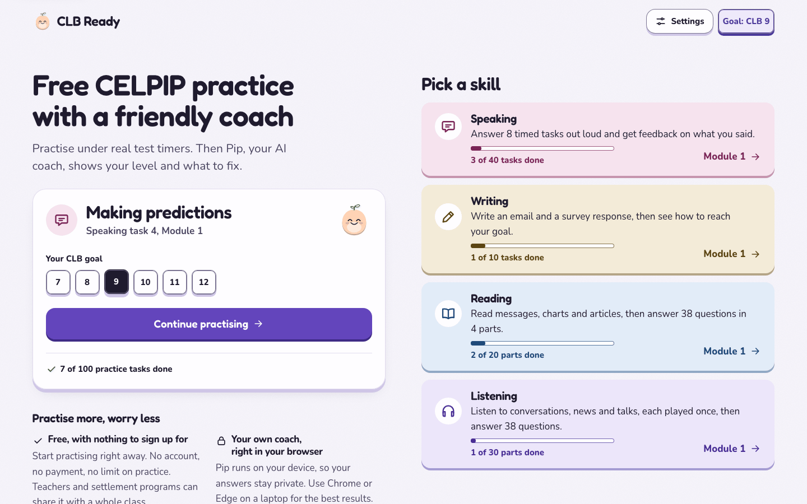

> CLB Ready is an independent practice tool. It is not affiliated with, endorsed by or connected to
> CELPIP, Prometric, the Centre for Canadian Language Benchmarks or the Government of Canada.
> Scores are estimates for practice only.

## What's inside

- **5 full practice tests**, each with 8 speaking tasks, 2 writing tasks, 4 reading parts and 6 listening parts.
- **Speaking with a coach.** Your answer is transcribed, measured (pace, pauses, fillers, word variety) and
  rewritten at your goal level, with every change marked.
- **40 sample answers at CLB 10+**, sized to the speaking time, with notes on why they work and a button to
  hear them read aloud.
- **Writing, marked like a teacher would**, in a test-style editor with a live word count, grammar marks,
  scores per criterion and an improved version.
- **380 reading and listening questions**, each with an explanation that quotes the line that proves it.
  Listening plays once, like test day, then shows the full transcript.
- **Goal-based feedback** for CLB 7 to 12, and ticks for finished tasks (saved only in your browser).

## Screenshots

| Speaking: test-style screen | Speaking: feedback at your goal level |
| --- | --- |
| 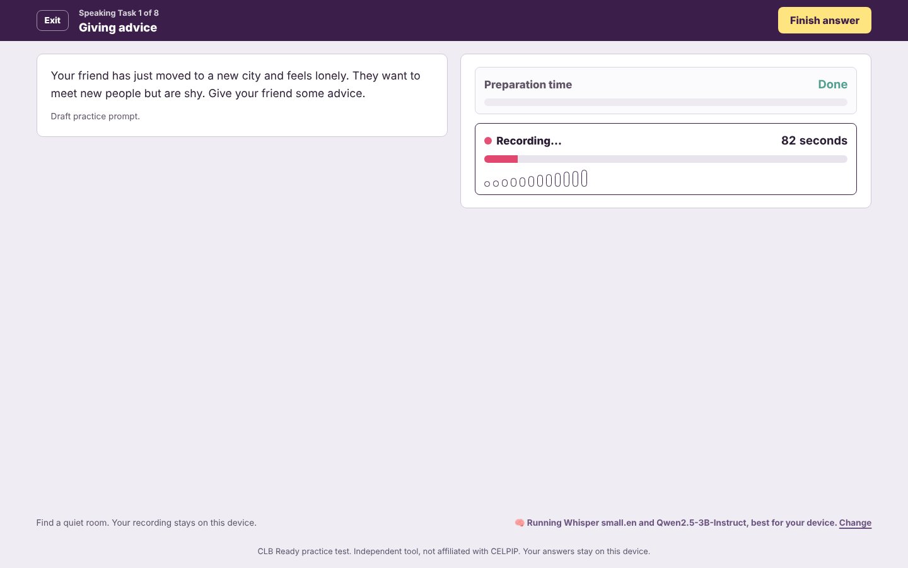 | 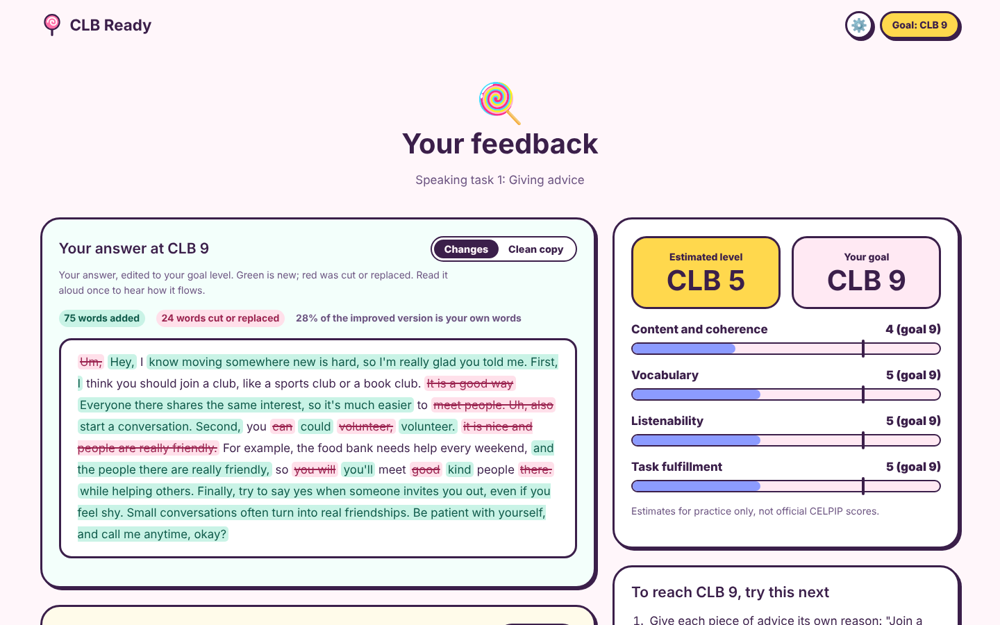 |
| **Writing: exam editor with word count** | **Writing: corrections and scores** |
| 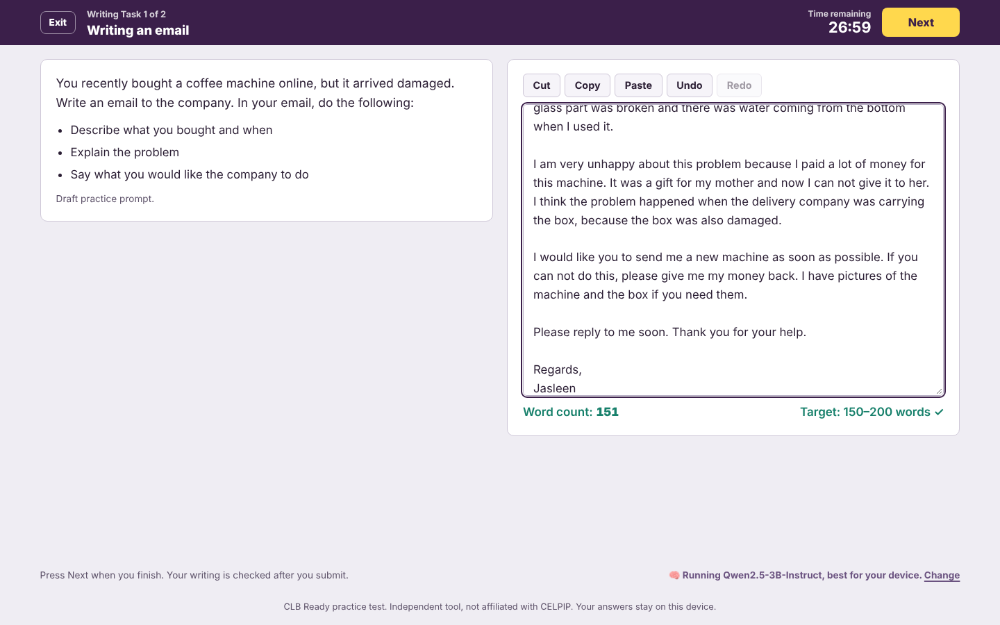 | 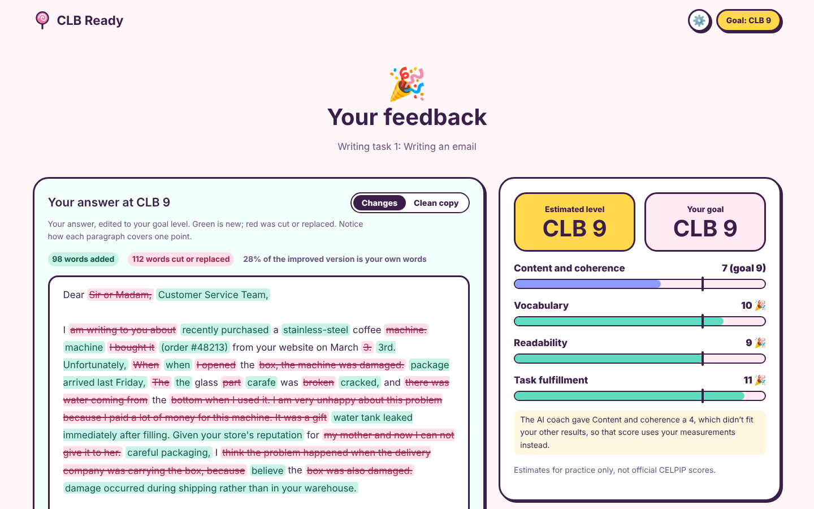 |
| **Reading: passage, chart and blanks** | **Reading: every answer explained** |
| 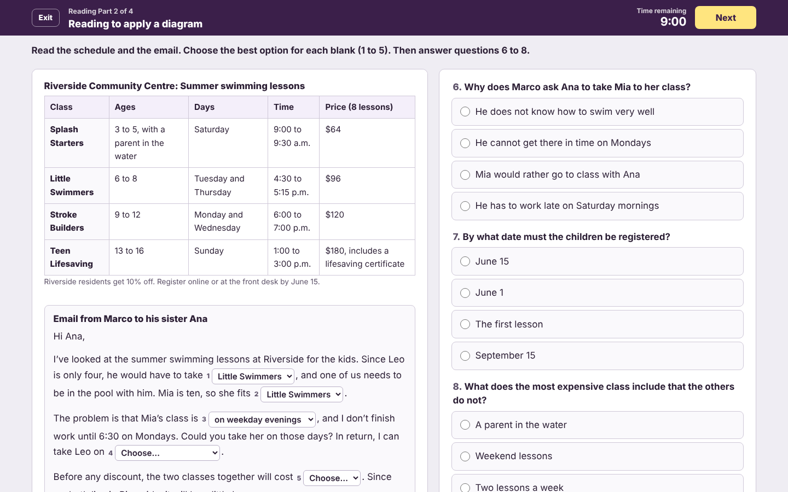 | 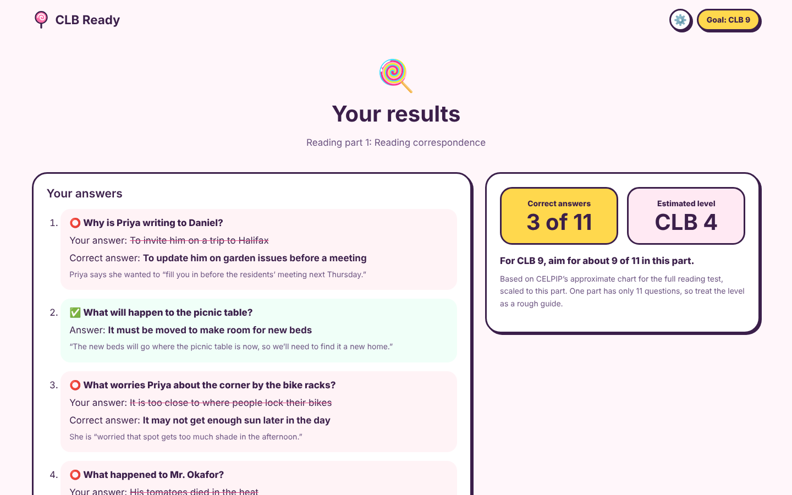 |
| **Listening: questions after one play** | **Sample answers you can hear** |
| 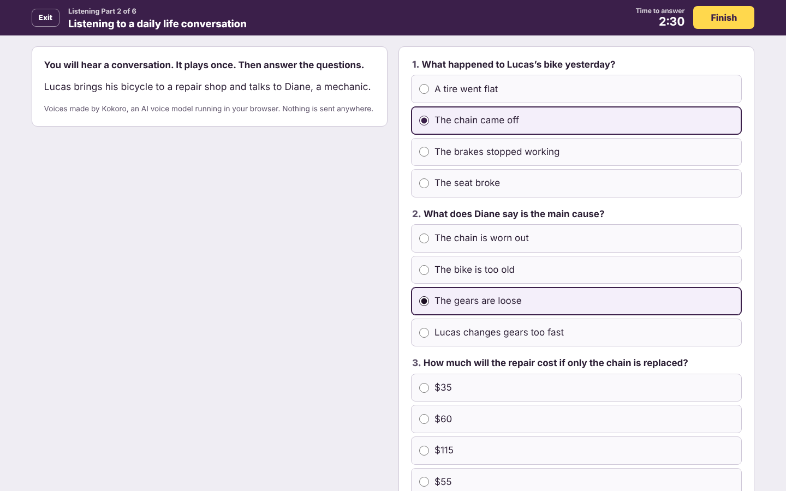 | 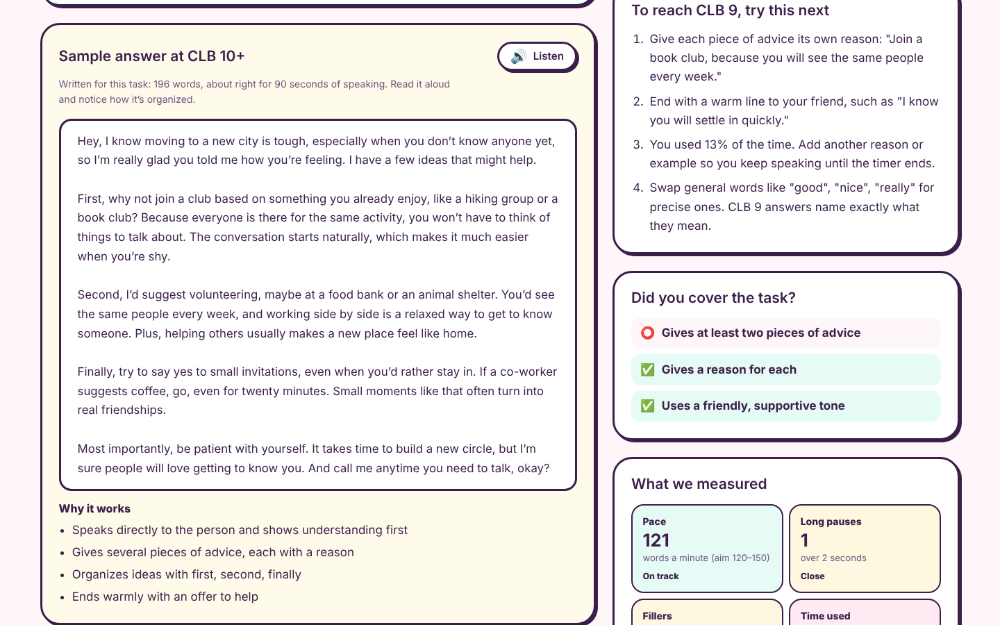 |
| **Progress ticks on every task** | **Works on phones too** |
| 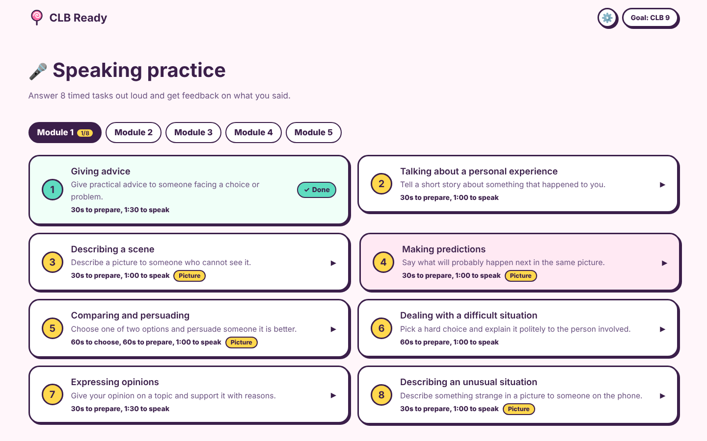 | 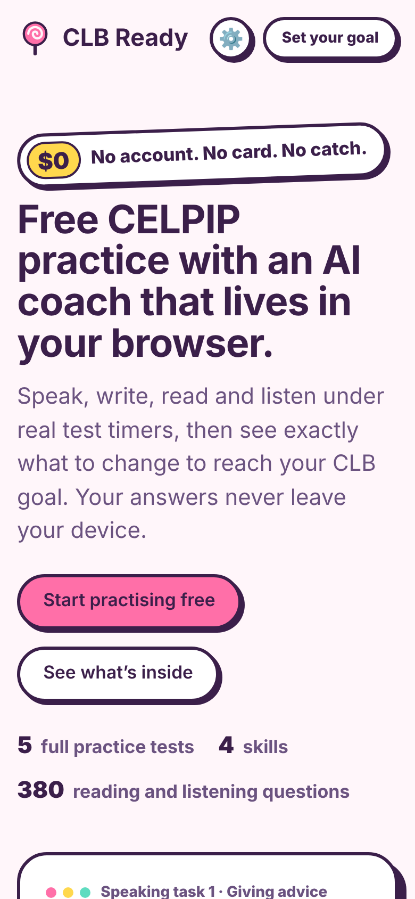 |

## Why it's free and private

Most AI apps send your voice to a server and pay for every request. CLB Ready downloads small open AI
models into your browser once, then runs everything on your own computer:

| Part | Tool | Where it runs |
| --- | --- | --- |
| Speech to text | Whisper (`.en` models) via Transformers.js | Web Worker, WebGPU or CPU |
| Feedback | Qwen2.5 / Llama 3.2, 4-bit, via WebLLM | Web Worker, WebGPU |
| Listening voices | Kokoro 82M via kokoro-js | Web Worker, WebGPU or CPU |
| Measurements and grammar checks | Plain TypeScript (pace, pauses, fillers, learner grammar rules) | Main thread |
| Reading and listening marks | Answer key and CELPIP's approximate score chart | Main thread |
| Storage | Model files are cached; answers are never saved | Browser |

The app checks the device (memory, CPU cores, WebGPU support) without asking for permission and picks
model sizes to match. Devices without WebGPU get light mode. Feedback comes in two steps, so scores
appear in seconds and the improved answer streams in while you read them.

## For schools and settlement programs

Share one link. There's nothing to install, no accounts to manage and no student data to protect,
because none is collected.

## Run it locally

You need Node.js 20 or newer.

```bash
npm install
npm run dev      # then open http://localhost:5173 in Chrome or Edge
npm test         # unit tests
npm run build    # production build in dist/
npm run audio    # optional: pre-record listening audio (see below)
```

Every push to `main` runs the tests and publishes the site (GitHub Actions to GitHub Pages, and Vercel).

### Listening recordings (optional)

By default, Kokoro makes the listening voices in the learner's browser, a line at a time while the
recording plays. `npm run audio` can instead pre-record clips as MP3 files in `public/audio/`; the app
plays a recording when one exists. It needs internet the first time (about 330 MB for the model) and
ffmpeg (`brew install ffmpeg` on a Mac). To skip onnxruntime-node's GPU (CUDA) download, install
with `ONNXRUNTIME_NODE_INSTALL_CUDA=skip npm install`.

Open `#/lab` (the "Model lab" link in the footer) to measure load time, transcription time, tokens per
second and memory on your device.

## Project structure

```
src/
  app/          router, session state, route table
  components/   shared UI (buttons, emoji, mascot, timer, layout)
  domain/       skills, CLB goals, CELPIP criteria, task types, scoring rules
  content/      practice modules, prompts, passages, listening scripts (data only)
  services/     device detection, audio, AI engines behind interfaces, grammar, progress
  features/     one folder per screen: home, goal, skill, task, results, settings, lab
  styles/       design tokens and CSS
tests/          unit tests for logic and content integrity
```

### Adding things

- **A module:** copy `src/content/modules/module1.ts` (and its `module1Reading.ts` and
  `module1Listening.ts`), write the new content, and list it in `src/content/modules/index.ts`.
  The content tests check every part is complete, every blank has a question, answers are spread out
  and sample answers fit the speaking time.
- **A different AI engine:** implement `SpeechToText`, `FeedbackModel` or `TextToSpeech` from `services/`.

## Licence

MIT. See [LICENSE](LICENSE).
