# CLB Ready

**Practise for CELPIP for free, and see the CLB level each answer would earn.**

CLB Ready is for adults taking the CELPIP test for Canadian immigration or citizenship. Practise speaking,
writing, reading and listening with the real test timers. After each answer, Pip, your AI coach, shows:

- your estimated CLB level next to the level you need
- what to change to close the gap
- your answer rewritten at your goal level, with every change marked

Pip runs inside your browser. There's no account and no payment, and nothing you say or write leaves your
device.

**[Start practising at clbready.vercel.app →](https://clbready.vercel.app)** (or use the
[GitHub Pages copy](https://jasleenminhas578.github.io/CLB_Ready/)). Chrome or Edge on a laptop works best.

<p align="center"></p>

## 🎯 Why learners use it

- 📈 **See your estimated CLB level for every answer**, next to the goal you picked (CLB 7 to 12). Speaking and
  writing get a score for each of the four CELPIP criteria; reading and listening use CELPIP's approximate
  score chart.
- 🤖 **Know exactly what to fix.** Pip checks that your answer is on task, ticks off the task checklist and
  gives up to three short tips. Then it rewrites your answer at your goal level, with every change marked.
- ⏱️ **Practise under test-day conditions**: 5 practice tests with 40 speaking tasks, 10 writing tasks and
  380 reading and listening questions, each with test-style timers.
- 🗣️ **Learn from strong answers.** 40 sample answers at CLB 10+, sized to the speaking time, which you can
  read or hear aloud. Every reading and listening question has an explanation that quotes the line that
  proves it.
- 🧭 **Pick up where you left off.** One click starts your next unfinished task, and each skill shows how
  many tasks you have done.
- 🆓 **Practise as much as you like.** No account, no payment, no limit, and your answers stay on your device.

## ✅ What you need

| | Works | Notes |
| --- | --- | --- |
| **Best** | Chrome or Edge on a laptop or desktop | WebGPU is on by default, so Pip can run. |
| **Also works** | Safari and Firefox with WebGPU turned on | They don't report memory, so CLB Ready picks the Balanced models. |
| **Light mode** | Any browser without WebGPU | Speech to text still works; Pip is off (see below). |
| **Phones** | Recent phones | Uses the Lightest models, or light mode if the phone's browser has no WebGPU. |

You also need a microphone for speaking, and room for the models in browser storage (several hundred MB to
a few GB, depending on the model size). The first download needs a good connection; after that the models
come from the browser cache.

## 🧭 How it works

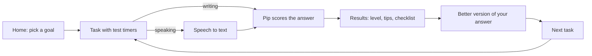

1️⃣ **Pick a goal and start.** Choose the CLB level you need on the start card; Start opens your next
unfinished task. Without a goal, feedback aims at CLB 9.

2️⃣ **Answer under test timers.** Each task looks and runs like test day. A soft beep marks when each timer
starts and ends, kept out of your recording (turn it off in Settings).

3️⃣ **Pip checks your answer.** Speech is turned into text on your device, then Pip reads it. The first time,
Pip downloads, and a panel shows the step and progress.

4️⃣ **See your level and what to fix.** Your estimated level beside your goal, a score per criterion, up to
three tips and the task checklist. No level shows until Pip has checked that you answered the question.

5️⃣ **Read a better version.** Pip rewrites your answer at your goal level, with every change marked.

6️⃣ **Go to the next task, or start again.** A task is ticked only when you gave an answer. Each module has a
Reset progress button, and Settings can clear everything.

| 1️⃣ Pick a goal | 3️⃣ Pip checks your answer |
| --- | --- |
|  | 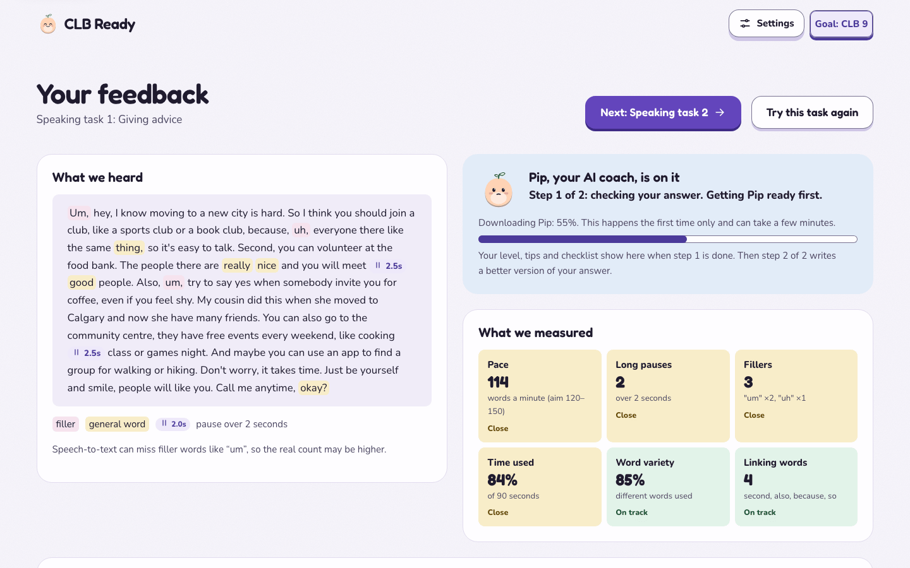 |
| **5️⃣ A better version, changes marked** | **6️⃣ Progress ticks and Reset progress** |
|  |  |

## 📸 Task and results, skill by skill

Each row shows the test-style task on the left and the feedback you get on the right.

| Task | Results |
| --- | --- |
| **🗣️ Speaking:** 8 task types per test, with the test's preparation and speaking times. Your answer is transcribed and measured (pace, pauses, fillers, word variety). | Level beside your goal, a score per criterion, tips and the task checklist. |
| 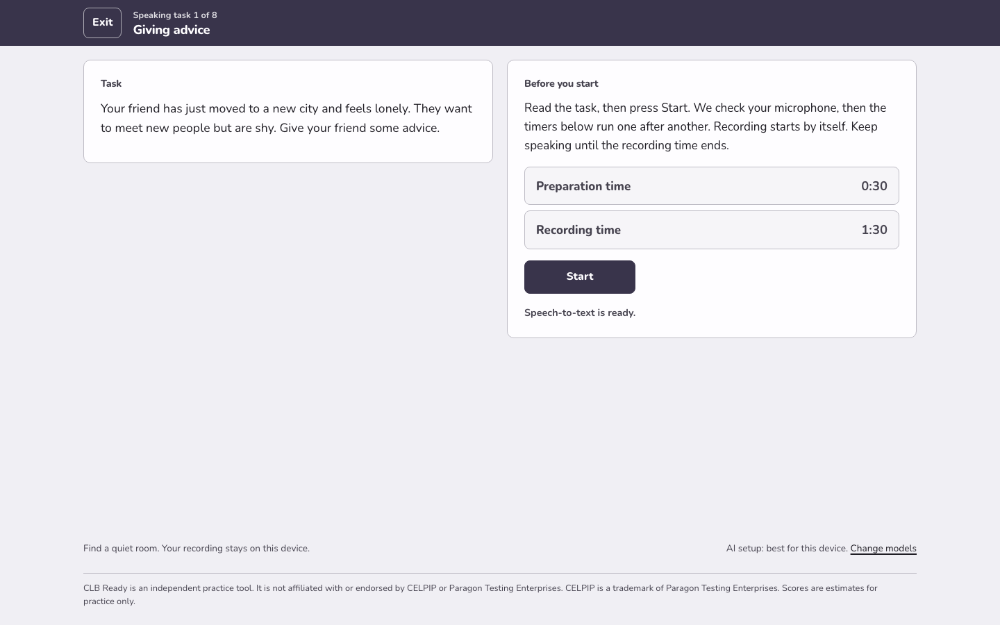 | 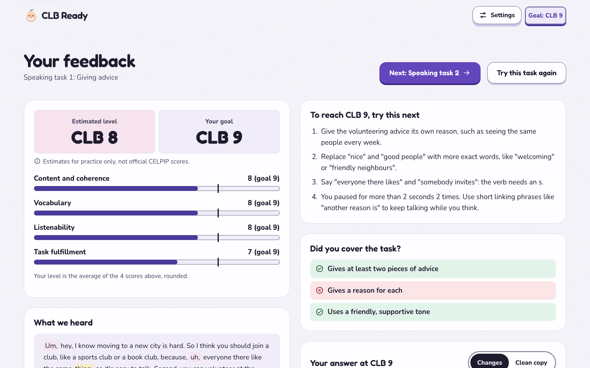 |
| **✍️ Writing:** an email and a survey response per test, in an editor with a live word count. Your draft stays in the tab until you submit. | Possible grammar mistakes marked, a score per criterion, the task checklist and an improved version. |
| 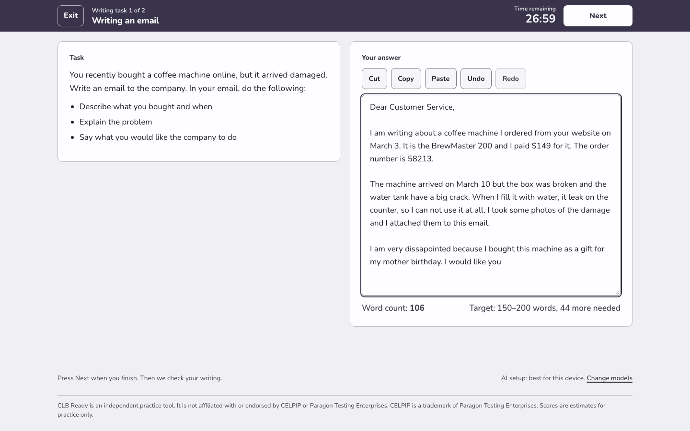 |  |
| **📖 Reading:** 4 parts per test, from correspondence to viewpoints. Fill blanks and answer questions on the clock. | Your score, an estimated level and, for every answer, the line that proves it. |
| 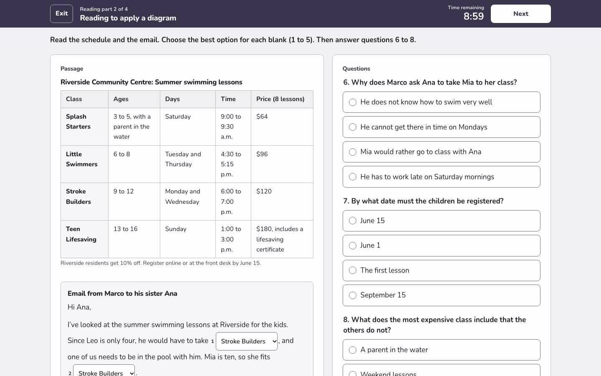 | 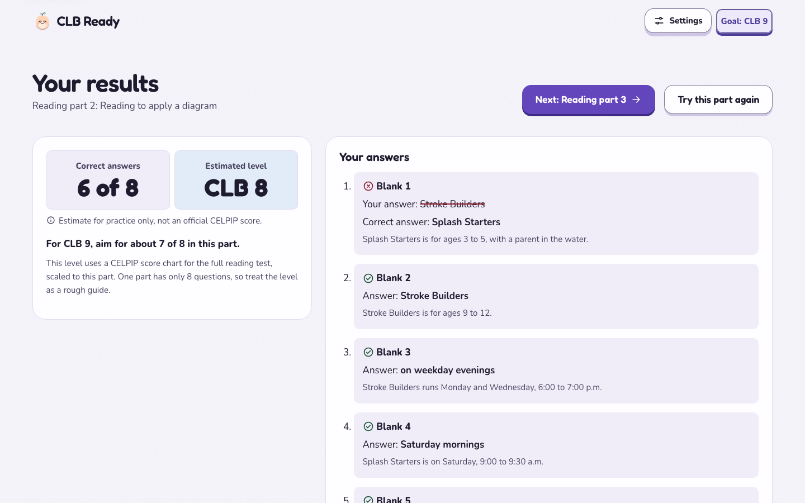 |
| **🎧 Listening:** 6 parts per test. Each recording plays once, like test day, then the questions appear. | Every answer explained with a quote from the recording, plus the full transcript. |
|  | 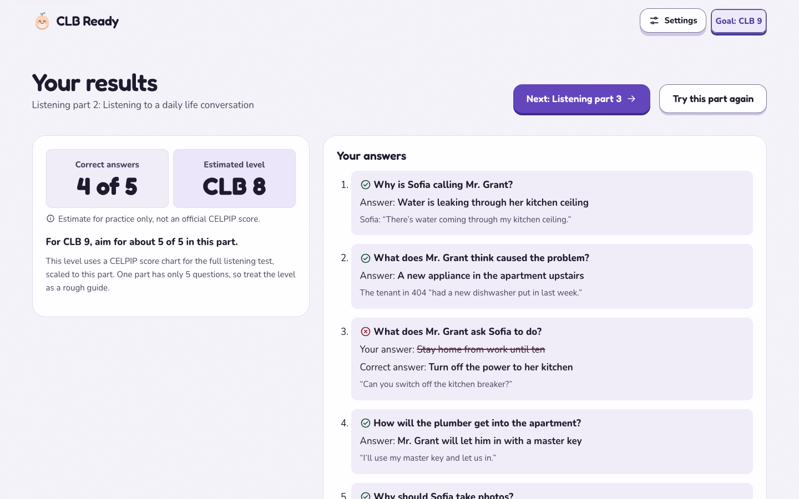 |

<details>
<summary>More screens: recording, sample answers, light mode and phone</summary>

| Recording a speaking answer | A sample answer at CLB 10+ |
| --- | --- |
| 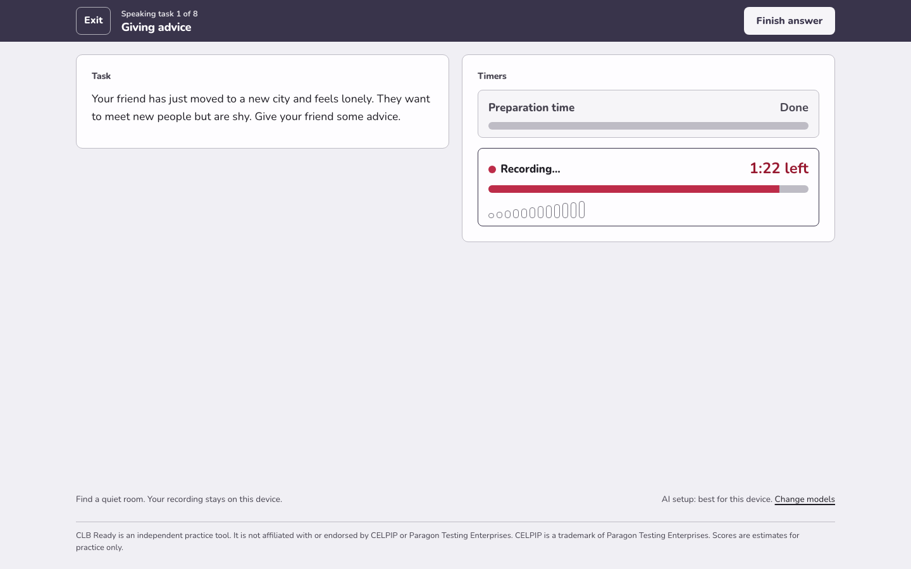 |  |
| **Light mode (no WebGPU)** | **On a phone** |
| 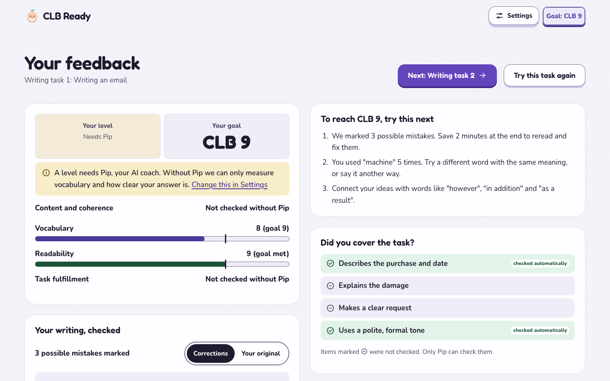 | 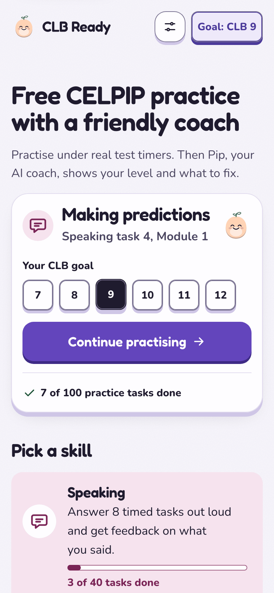 |

</details>

## 📊 How scores are estimated

Scores are estimates to guide practice, not a prediction of your test result.

**Speaking and writing** are scored on CELPIP's four criteria (content and coherence, vocabulary,
listenability or readability, and task fulfillment), each from CLB 4 to 12.

1. **Code measures what it can count**: pace, pauses, fillers, word variety, linking words, length and
   possible grammar mistakes. Code alone never gives a level above CLB 10, and it never scores content or
   task fulfillment on screen, because it can't judge meaning.
2. **Pip judges what needs understanding**: whether the answer is on task, how well it is organised, and a
   score for each criterion.
3. **The two are blended.** Pip's share is largest for content (70%) and smallest for listenability (30%)
   or readability (40%).
4. **Safety checks.** A score from Pip that is far from both its other scores and what code measured is
   ignored, because small models sometimes slip. Short answers are capped. An answer to a different
   question is capped at CLB 5, however fluent it is.
5. **Your level for the answer** is the rounded average of the four criteria. No level shows without Pip.

**Reading and listening** are marked against the answer key, and your score is turned into a level with
CELPIP's approximate score chart.

The scoring rules are plain TypeScript in [`src/domain/scoring/`](src/domain/scoring/), and a calibration
test checks that strong, middle and weak sample answers land in the expected bands.

## 🔒 Private by design

CLB Ready has no server of its own: the site is static files. It downloads small open AI models into your
browser once, then runs everything on your own computer:

| Part | Tool | Where it runs |
| --- | --- | --- |
| Speech to text | Whisper (`.en` models) via Transformers.js | Web Worker, WebGPU or CPU |
| Feedback (Pip) | Qwen2.5 / Llama 3.2, 4-bit, via WebLLM | Web Worker, WebGPU |
| Listening voices and read-aloud | Kokoro 82M via kokoro-js | Web Worker, WebGPU or CPU |
| Measurements and grammar checks | Plain TypeScript (pace, pauses, fillers, learner grammar rules) | Main thread |
| Reading and listening marks | Answer key and CELPIP's approximate score chart | Main thread |

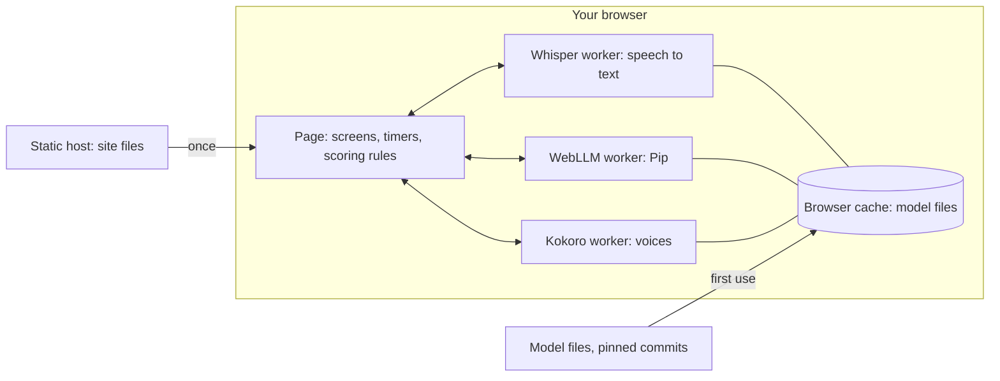

- **Nothing you say or write leaves your device.** Apart from the site's own files, the only downloads are
  the models. There is no account, no analytics and no app server.
- **Pinned models.** Every model is pinned to an exact commit (`src/services/modelPins.ts`), so a change
  upstream can't swap what runs on your device.
- **No third-party code at runtime.** The ONNX Runtime WebAssembly file and the fonts are served from the
  site itself, not a CDN.
- **A strict Content Security Policy.** The built page only loads scripts, styles, fonts and data from the
  site itself.

The app checks the device (memory, CPU cores, WebGPU support) without asking for permission and picks model
sizes to match. Devices without WebGPU get light mode, where Pip is off: results show the measured scores
(vocabulary and how clear your answer is) and say that a level needs Pip.

### Models for each device

| Setting | Chosen when | Feedback (Pip) | Speech to text | Voices |
| --- | --- | --- | --- | --- |
| Largest | 8 GB memory or more, 8+ cores and a strong GPU | Qwen2.5 3B | Whisper small.en (GPU) | Kokoro, full precision on the GPU (about 330 MB) |
| Balanced | Most laptops, and browsers that don't report memory | Qwen2.5 1.5B | Whisper base.en (GPU) | Kokoro 8-bit on the CPU (about 90 MB) |
| Lightest | Phones, or 4 GB memory or less | Llama 3.2 1B | Whisper tiny.en (GPU) | Kokoro 8-bit on the CPU |
| Light mode | No WebGPU | Off | Whisper tiny.en (CPU) | Kokoro 8-bit on the CPU |

Pip's models are 4-bit, using 16-bit floats where the GPU supports them. If a model fails to load, CLB
Ready steps down one size and tells you. You can pick a size yourself in Settings.

### What is saved in your browser

| What | Where | How to clear it |
| --- | --- | --- |
| Model files | Browser cache | Settings → Delete downloaded models |
| Which tasks you finished, and the date (never answers, recordings or scores) | localStorage | Settings → Clear my progress, or Reset progress on a module |
| Timer sounds on or off | localStorage | Settings → Sounds |
| Writing draft, until you submit it | sessionStorage, cleared when the tab closes | Submit or close the tab |

Recordings stay in memory only while Pip checks them. Nothing is uploaded.

## 🛠️ Troubleshooting

- **Pip's first check is slow.** The model downloads once, then loads from the cache. Keep the tab open
  until the progress panel finishes.
- **The microphone doesn't record.** Allow the microphone for the site in the browser's address
  bar, then try the task again. Speaking needs a secure page (https or localhost).
- **Pip is off or results say a level needs Pip.** The browser has no WebGPU. Use an up-to-date Chrome or
  Edge, or check that hardware acceleration is on in the browser's settings.
- **A model won't load.** CLB Ready steps down a size by itself. If the tab still runs out of memory,
  choose Lightest in Settings and close other heavy tabs.
- **Progress ticks disappear.** Private windows and strict privacy settings can block storage. Practice
  still works, but ticks last only until the tab closes.
- **Running low on disk space.** Settings shows how much the models use and can delete them.

## 🏫 For teachers and settlement programs

Share one link. There's nothing to install, no accounts to manage and no student data to protect, because
none is collected. Students get 5 full practice tests across all four skills, feedback aimed at the level
they need, and a sample answer for every speaking task. Progress ticks are kept in each student's own
browser, and it also works on phones.

## 💻 Run it locally

You need Node.js 20 or newer.

```bash
npm install
npm run dev        # then open http://localhost:5173 in Chrome or Edge
npm test           # unit tests
npm run typecheck  # TypeScript check
npm run build      # production build in dist/
npm run audio      # optional: pre-record listening audio (see below)
```

The dev server has no Content Security Policy, because Vite uses inline scripts there. `npm run build`
adds it, so check anything network-related with `npm run build && npm run preview`.

### Tech stack

React 19, TypeScript and Vite, with no router library and plain CSS (design tokens in
`src/styles/tokens.css`). WebLLM, Transformers.js and kokoro-js each run in their own Web Worker. Tests use
Vitest.

## 🚀 Deploying your own copy

The build in `dist/` is plain static files with relative paths, so it works on any static host and under a
sub-path.

- **GitHub Pages:** fork the repo, turn on Pages with "GitHub Actions" as the source, and push to `main`.
  [`.github/workflows/deploy.yml`](.github/workflows/deploy.yml) runs the tests, builds and publishes. It
  installs with `--ignore-scripts` and pins every action to a commit.
- **Other hosts (Vercel, Netlify and so on):** build command `npm run build`, output folder `dist`.

The Content Security Policy is a `<meta>` tag added at build time (see `vite.config.ts`), because GitHub
Pages can't send headers.

## 🔊 Listening recordings

By default, Kokoro makes the listening voices in the learner's browser, a line at a time while the
recording plays. `npm run audio` can instead pre-record clips as MP3 files in `public/audio/`; the app
plays a recording when one exists. It needs internet the first time (about 330 MB for the model) and
ffmpeg (`brew install ffmpeg` on a Mac). To skip onnxruntime-node's GPU (CUDA) download, install
with `ONNXRUNTIME_NODE_INSTALL_CUDA=skip npm install`.

## 🧪 Model lab

Open `#/lab` (the "Model lab" link in the footer) to measure load time, transcription time, tokens per
second and memory on your device.

## 🗂️ Project structure

```
src/
  app/          router, session state, route table
  components/   shared UI (buttons, icons, Pip, layout, disclaimer)
  domain/       skills, CLB goals, CELPIP criteria, task types, scoring rules
  content/      practice modules, prompts, passages, listening scripts (data only)
  services/     device detection, audio, AI engines behind interfaces, grammar, progress
  features/     one folder per screen: home, goal, skill, task, results, settings, lab
  styles/       design tokens and CSS
tests/          unit tests for logic and content integrity
scripts/        make-audio.ts for pre-recorded listening clips
```

The tests cover scoring and calibration, timers, the device tiers, model pins, progress, worker messages
and content integrity. They run in Node, without a browser or models.

## ➕ Adding things

- **A module:** copy `src/content/modules/module1.ts` (and its `module1Reading.ts` and
  `module1Listening.ts`), write the new content, and list it in both `src/content/modules/index.ts` and
  `src/content/modules/catalog.ts`.
  The content tests check every part is complete, every blank has a question, answers are spread out
  and sample answers fit the speaking time.
- **A different AI engine:** implement `SpeechToText`, `FeedbackModel` or `TextToSpeech` from `services/`.

## 🤝 Contributing

Issues and pull requests are welcome. Before opening a pull request, run `npm test`, `npm run typecheck`
and `npm run build`. Keep learner data on the device: don't add network calls apart from model downloads.
Write learner-facing text in plain English, in short sentences.

## 📄 Licence

MIT. See [LICENSE](LICENSE).

> CLB Ready is an independent practice tool. It is not affiliated with or endorsed by CELPIP or Paragon Testing
> Enterprises. CELPIP is a trademark of Paragon Testing Enterprises. Scores are estimates for practice only.
